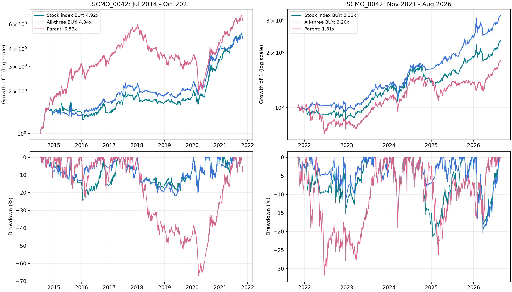

# Stock-level index BUY test

SCMO_0042: annual return changes from 24.04% to 24.32% in 2014-21, and from 27.45% to 19.25% in 2021-26. The stock filter modestly improves early-window returns across all four books, but trails the all-three rule in all four recent-window comparisons.

It does not resolve the early parent gap in 0042. In 2015, 86.2% of the basket weight on average reads Smallcap 100, so most names still move together under a single signal. The new rule returns -1.76% that year versus -4.48% for the all-three rule and +79.14% for the parent. In 2016 it gives back ground: -0.98% versus +23.80% for the all-three rule.

Each week, buy or retain a parent stock only while its assigned index is BUY. Qualifying names keep their parent target weights; the remainder goes to the existing MAUc1-timed gold/cash sleeve (80/20 on gold BUY, 20/80 on SELL, 50/50 before its first signal).

Classification uses the latest available monthly market-cap rank: ranks 1-100 read Nifty 100; 101-250 read Midcap 100; 251-900 read Smallcap 100. Ranks above 900 and unranked stocks also read Smallcap 100 in the primary run. A separate sensitivity sends this Unknown bucket to the sleeve. These are market-cap proxies, not verified historical membership of the three indices.

All classifications are refreshed at the weekly review using snapshots dated on or before that review. The 2014-19 and 2019-26 rank caches are joined; no frozen July 2019 classification is carried through 2021. No manual classification overrides or current membership snapshots are applied.

Same parent baskets, daily prices, next-session fills, close valuation and 20.8 bps round-trip cost as the final-strategy report. An unchanged target does not trade, so holdings drift. When the target changes (including a gold split change), all positions are reset to the new target weights. The engine redistributes unfillable target weights across fillable assets; audit.csv records their incidence.

## 2014_2021

| Book | Strategy | CAGR | Max drawdown | End value | Avg equity target |
| --- | --- | --- | --- | --- | --- |
| SCMO_0042 | Stock index BUY | 24.32% | -24.45% | 4.92x | 56.9% |
| SCMO_0042 | All-three BUY | 24.04% | -21.66% | 4.84x | 46.8% |
| SCMO_0042 | Parent | 29.31% | -67.06% | 6.57x | 99.7% |
| SCMO_0043 | Stock index BUY | 15.99% | -25.53% | 2.96x | 60.2% |
| SCMO_0043 | All-three BUY | 11.61% | -21.09% | 2.24x | 46.8% |
| SCMO_0043 | Parent | 17.71% | -60.18% | 3.30x | 99.7% |
| SCMO_0044 | Stock index BUY | 19.27% | -29.51% | 3.63x | 57.1% |
| SCMO_0044 | All-three BUY | 18.98% | -26.73% | 3.57x | 46.8% |
| SCMO_0044 | Parent | 27.58% | -62.90% | 5.95x | 99.7% |
| SCMO_0045 | Stock index BUY | 19.76% | -31.59% | 3.74x | 57.9% |
| SCMO_0045 | All-three BUY | 18.79% | -25.71% | 3.53x | 46.8% |
| SCMO_0045 | Parent | 26.83% | -44.69% | 5.70x | 99.7% |

## live

| Book | Strategy | CAGR | Max drawdown | End value | Avg equity target |
| --- | --- | --- | --- | --- | --- |
| SCMO_0042 | Stock index BUY | 19.25% | -21.32% | 2.33x | 57.4% |
| SCMO_0042 | All-three BUY | 27.45% | -20.38% | 3.20x | 48.7% |
| SCMO_0042 | Parent | 13.16% | -31.95% | 1.81x | 99.8% |
| SCMO_0043 | Stock index BUY | 15.56% | -24.92% | 2.00x | 55.1% |
| SCMO_0043 | All-three BUY | 22.16% | -20.38% | 2.61x | 48.7% |
| SCMO_0043 | Parent | 6.13% | -29.07% | 1.33x | 99.8% |
| SCMO_0044 | Stock index BUY | 20.06% | -20.16% | 2.40x | 60.6% |
| SCMO_0044 | All-three BUY | 29.28% | -21.46% | 3.43x | 48.7% |
| SCMO_0044 | Parent | 19.27% | -28.37% | 2.33x | 99.8% |
| SCMO_0045 | Stock index BUY | 19.00% | -19.06% | 2.30x | 60.3% |
| SCMO_0045 | All-three BUY | 27.52% | -20.38% | 3.21x | 48.7% |
| SCMO_0045 | Parent | 16.04% | -31.26% | 2.04x | 99.8% |

## SCMO_0042 yearly returns

First and last years of each window are partial.

| period | year | All-three BUY | Parent | Stock index BUY |
| --- | --- | --- | --- | --- |
| 2014_2021 | 2014 | 40.96% | 75.53% | 44.37% |
| 2014_2021 | 2015 | -4.48% | 79.14% | -1.76% |
| 2014_2021 | 2016 | 23.80% | 3.60% | -0.98% |
| 2014_2021 | 2017 | 28.17% | 70.89% | 31.35% |
| 2014_2021 | 2018 | -12.72% | -34.38% | -10.22% |
| 2014_2021 | 2019 | 16.00% | -7.95% | 11.97% |
| 2014_2021 | 2020 | 83.92% | 30.83% | 80.66% |
| 2014_2021 | 2021 | 21.67% | 49.21% | 46.90% |
| live | 2021 | -1.88% | -2.35% | -1.88% |
| live | 2022 | -1.63% | -15.68% | -11.12% |
| live | 2023 | 34.90% | 34.22% | 43.12% |
| live | 2024 | 24.72% | 29.01% | 12.39% |
| live | 2025 | 48.73% | -4.36% | 33.79% |
| live | 2026 | 32.55% | 32.70% | 23.98% |

## Verification and limits

All 16 baseline NAV comparisons pass; maximum daily NAV error against the existing report is 3.55e-15.

Target-logic checks pass for mixed BUY/SELL signals, all BUY, all SELL, parent-weight preservation and Unknown-to-sleeve handling. Every decision asserts that its classification snapshot is not future-dated and its fill occurs after the review.

The early SCMO_0042 run has 82 stock/review target observations with no fill price (including repeated weekly observations); the engine redistributes these weights across fillable assets, as in the baseline. All four recent-window stock-filter runs have zero such observations. These early price gaps limit the precision of the historical comparison.

Classification coverage and the Unknown-to-sleeve sensitivity are saved alongside the main results. This is a retrospective comparison motivated by observed results, not an untouched out-of-sample test.

Files: summary_stats.csv; yearly_returns.csv; nav_curves_daily.csv; stock_decisions_weekly.csv; trade_log.csv; position_log.csv; equity_targets_daily.csv; classification_coverage.csv; audit.csv; baseline_reconciliation.csv.